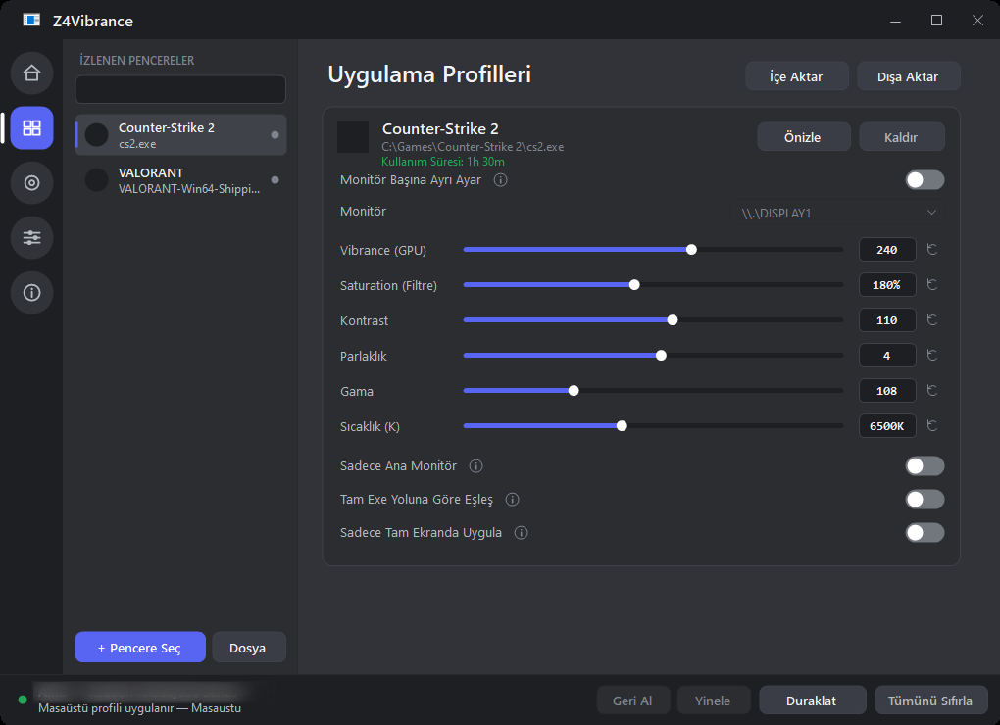
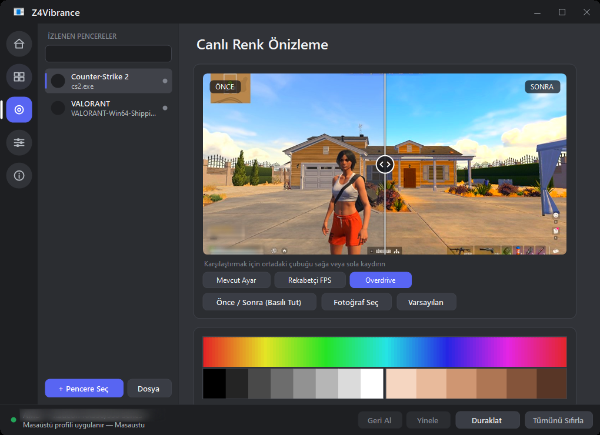
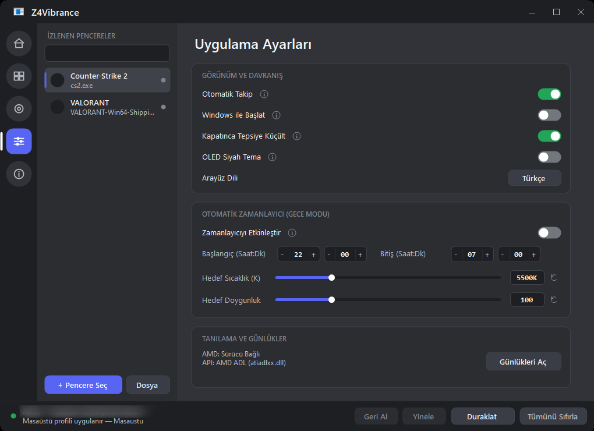
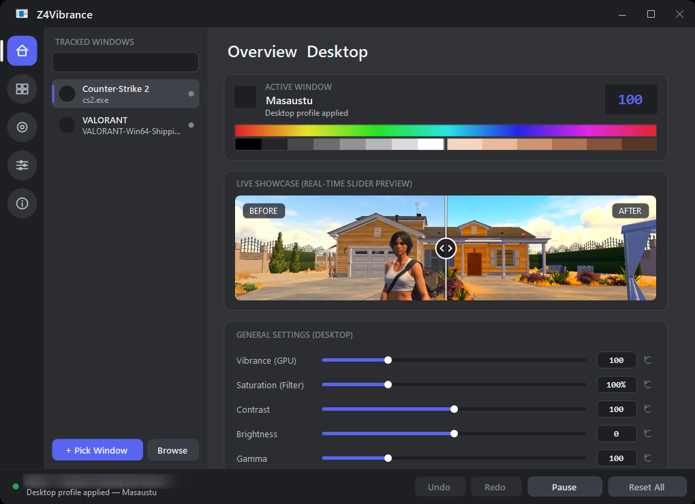
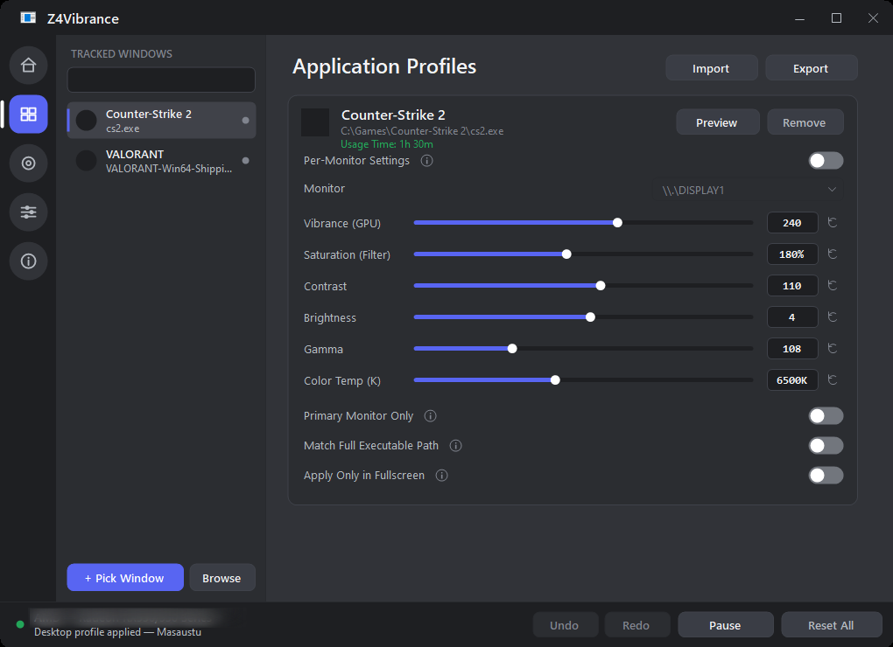
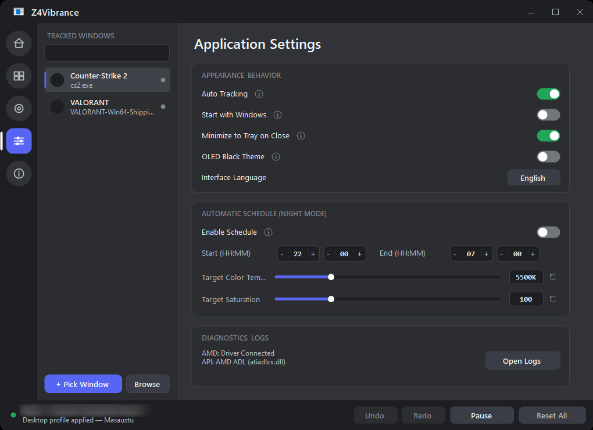

<div align="center">

# Z4Vibrance

**AMD Radeon ve NVIDIA ekran kartları için hafif, tamamen yerel dijital vibrance / renk ayarı aracı.**  
**Lightweight, fully local digital vibrance / color tool for AMD Radeon and NVIDIA GPUs.**

Oyun veya uygulama öne geldiğinde renk profilini otomatik uygular, çıkınca masaüstü ayarlarına geri döner.  
Automatically applies per-app color profiles when a game or app comes to the foreground and restores desktop settings on exit.


[Türkçe](#türkçe) · [English](#english)

<br/>


</div>

---

## Türkçe

### Ekran Görüntüleri

| Genel Bakış | Uygulama Profilleri |
| :---: | :---: |
|  |  |

| Canlı Önizleme | Ayarlar & Zamanlayıcı |
| :---: | :---: |
|  |  |

### Özellikler

- **Uygulama başına profil**: exe adı veya tam yol eşleştirme, profil başına uygulama/geri dönüş gecikmesi, "sadece tam ekranda uygula".
- **Ayarlar**: **Vibrance (GPU, AMD'de 0–400)**, **Saturation (Windows Renk Filtresi, %0–%400 Overdrive)**, kontrast, parlaklık, gama, renk sıcaklığı.
- **Hazır ön ayarlar**: Rekabetçi FPS, **Overdrive**, Sinematik, Doğal, Göz Rahatlığı, Okuma + kendi ön ayarını kaydetme.
- **Çoklu monitör**: profil başına monitör seçimi ve monitör başına ayrı değerler.
- **Zamanlayıcı (gece modu)**: belirli saatlerde otomatik renk sıcaklığı.
- **Profil içe/dışa aktarma** (JSON), kopyalama, yeniden adlandırma.
- **Geri al / yinele**, sürüklenebilir **Önce / Sonra (Before / After)** canlı fotoğraf önizleme & Genel sekme showcase'i, kendi fotoğrafını yükleme ve canlı renk şeridi.
- **Güvenlik ağı**: program kapanır veya çökerse renkler varsayılana döner; düzgün kapanmayan oturum bir sonraki açılışta tespit edilip sıfırlanır.
- **Sağlam yapılandırma**: atomik kayıt, `.bak` yedeği ve bozuk dosyada otomatik geri yükleme.
- Discord / Spotify tarzı karanlık arayüz, OLED siyah tema, Türkçe + İngilizce dil desteği.
- Boşta CPU kullanımı ~%0 (polling yok, olay tabanlı takip).

### Güvenlik ve Anti-Cheat

Z4Vibrance anti-cheat sistemleri (Vanguard, EAC, BattlEye, FACEIT vb.) tarafından şüpheli görülebilecek hiçbir yöntem kullanmaz:

| Kullanılan | Kullanılmayan |
|---|---|
| AMD ADL (`atiadlxx.dll`) – resmi sürücü API'si | DLL injection, hook, overlay |
| NVIDIA NVAPI (`nvapi64.dll`) – resmi sürücü API'si | Oyun belleğini okuma / yazma |
| Windows GDI `SetDeviceGammaRamp` | Global kısayol (`RegisterHotKey`), klavye hook'u |
| Windows Magnification API (`System32\Magnification.dll`) | Sürücü dosyası / sürücü registry anahtarı değiştirme |
| `SetWinEventHook(EVENT_SYSTEM_FOREGROUND)` | İnternet bağlantısı, telemetri, otomatik güncelleme |

> [!NOTE]
> Hiçbir yazılım için %100 ban garantisi verilemez; ancak Z4Vibrance yalnızca üreticilerin resmi renk API'lerini kullanır ve oyun süreçlerine hiçbir şekilde dokunmaz. Yönetici yetkisi gerektirmez.

### Donanım Desteği

| Ayar | AMD (ADL) | NVIDIA (NVAPI) |
|---|---|---|
| Doygunluk / Vibrance (GPU) | ✅ (0–400) | ✅ (Digital Vibrance) |
| Saturation (Renk Filtresi) | ✅ (%0–%400, borderless/windowed) | ✅ (%0–%400, borderless/windowed) |
| Kontrast | ✅ | ❌ Desteklenmiyor |
| Parlaklık | ✅ | ❌ Desteklenmiyor |
| Renk sıcaklığı | ✅ (sürücü destekliyorsa) | ❌ Desteklenmiyor |
| Gama | ✅ (Windows GDI) | ✅ (Windows GDI) |

Desteklenmeyen ayarlar arayüzde açıkça "desteklemiyor" olarak gösterilir.

> [!NOTE]
> **Test Durumu:** AMD Radeon üzerinde test edilmiştir. NVIDIA (NVAPI) desteği resmi NVAPI üzerinden eklenmiştir ancak fiziksel NVIDIA ekran kartı üzerinde henüz test edilmemiştir.

### Gereksinimler

- Windows 10 veya 11 (64 bit)
- .NET Framework 4.x (Windows 10/11'de varsayılan olarak yüklüdür)
- Güncel AMD veya NVIDIA ekran kartı sürücüsü

### İndirme

Hazır `Z4Vibrance.exe` dosyasını [Releases](../../releases) sayfasından indirebilirsiniz. Kurulum gerekmez; çift tıklayıp çalıştırın.

### Kaynaktan Derleme

Visual Studio veya NuGet gerekmez. Windows'un içindeki .NET Framework derleyicisi (`csc.exe`) kullanılır.

```powershell
git clone https://github.com/zodi4ctvn/Z4Vibrance.git
cd Z4Vibrance
powershell -ExecutionPolicy Bypass -File .\build.ps1
```

Çıktı: `bin\Z4Vibrance.exe`

| Parametre | Açıklama |
|---|---|
| `-Run` | Derleme sonrası programı başlatır |
| `-RegenerateIcon` | `Z4Vibrance.ico` dosyasını yeniden üretir |

> [!IMPORTANT]
> Derlemeden önce açık olan Z4Vibrance'i tepsi simgesinden **Çıkış** ile kapatın; aksi halde exe kilitli olduğu için üzerine yazılamaz (`CS0016`).

### Proje Yapısı

```
Z4Vibrance/
├── Core/                      # İş mantığı ve donanım katmanı
│   ├── IVibranceBackend.cs    # GPU backend arayüzü
│   ├── AmdVibranceBackend.cs  # AMD ADL uygulaması
│   ├── NvidiaVibranceBackend.cs# NVIDIA NVAPI uygulaması
│   ├── BackendFactory.cs      # GPU algılama + demo geri dönüşü
│   ├── GammaRampHelper.cs     # Windows GDI gama
│   ├── ColorFilterHelper.cs   # Windows Magnification renk filtresi (%0–%400)
│   ├── IntegrityGuard.cs      # Marka ve atıf bütünlüğü koruması
│   ├── WindowWatcher.cs       # Olay tabanlı ön plan pencere takibi
│   ├── TransitionEngine.cs    # Debounce + yumuşak renk geçişi
│   ├── PresetManager.cs       # Ön ayarlar, JSON içe/dışa aktarma
│   ├── UndoRedoManager.cs     # Geri al / yinele
│   ├── Logger.cs              # Döngüsel yerel günlük (~1 MB)
│   ├── Localization.cs        # TR / EN metinler
│   └── IconGenerator.cs       # Uygulama ikonu çizimi
├── Models/
│   └── AppConfig.cs           # Yapılandırma, atomik kayıt, göç
├── UI/
│   ├── Theme.cs               # Tüm renk / boşluk / font değerleri
│   ├── CustomControls.cs      # Özel çizimli kontroller + animasyon
│   ├── MainForm.cs            # Ana pencere
│   ├── WindowPickerForm.cs    # Açık pencere seçici
│   └── OnboardingForm.cs      # İlk açılış sihirbazı
├── Properties/
│   └── AssemblyInfo.cs        # Sürüm ve yazar bilgisi
├── Program.cs                 # Giriş noktası, tek örnek, güvenlik ağı
├── app.manifest               # PerMonitorV2 DPI, asInvoker
├── Z4Vibrance.ico
└── build.ps1                  # Derleme betiği
```

### Veri Konumu

Tüm veriler yereldir:

| Dosya | Konum |
|---|---|
| Yapılandırma | `%AppData%\Z4Vibrance\config.json` (+ `config.json.bak`) |
| Günlükler | `%AppData%\Z4Vibrance\logs\z4vibrance.log` |

Programı tamamen kaldırmak için exe'yi ve `%AppData%\Z4Vibrance` klasörünü silmeniz yeterlidir. "Windows ile başlat" açıksa önce kapatın (`HKCU\...\Run` girdisini kaldırır).

### Sorun Giderme

- **"Sürücü bağlı değil"**: AMD/NVIDIA sürücüsü yüklü değil veya API yanıt vermiyor. Program demo modunda yalnızca gama ayarı yapar. Ayarlar → *Günlükleri Aç* ile detaya bakın.
- **Renkler takılı kaldı**: Durum çubuğundaki *Tümünü Sıfırla* butonuna basın veya programı yeniden başlatın.
- **Derleme hatası CS0016**: Z4Vibrance hâlâ açık; tepsiden çıkış yapın.

### Lisans

[Custom Non-Commercial Attribution License](LICENSE) — Copyright © 2026 [Zodi4c](https://github.com/zodi4ctvn). Ticari olmayan kişisel kullanım için ücretsizdir; yazar atfının korunması zorunludur.

### Yasal Uyarı ve Ticari Markalar

Z4Vibrance bağımsız bir projedir; AMD, NVIDIA, Microsoft, Discord veya Spotify ile bağlantılı değildir, bu kurumlar tarafından onaylanmamış veya desteklenmemiştir. Tüm ürün adları, logolar ve ticari markalar ilgili sahiplerine aittir. Yazılım [Custom Non-Commercial Attribution License](LICENSE) kapsamında "OLDUĞU GİBİ" (AS IS) sunulmaktadır.

---

## English

### Screenshots

| Overview & Desktop | Application Profiles |
| :---: | :---: |
|  |  |

| Live Color Preview | Settings & Schedule |
| :---: | :---: |
|  |  |

### Features

- **Per-app profiles**: exe name or full path matching, per-profile apply/revert delays, "apply only in fullscreen" mode.
- **Color controls**: **Vibrance (GPU, 0–400 on AMD)**, **Saturation (Windows Color Filter, 0%–400% Overdrive)**, contrast, brightness, gamma, color temperature.
- **Built-in presets**: Competitive FPS, **Overdrive**, Cinematic, Natural, Eye Care, Reading + save your own custom presets.
- **Multi-monitor**: per-profile monitor selection and individual per-monitor color values.
- **Schedule (night mode)**: automatic color temperature and saturation at scheduled hours.
- **Profile import/export** (JSON), duplicate, rename.
- **Undo / redo**, draggable **Before / After** live photo preview & General tab showcase, custom image loading, and live color preview strip.
- **Safety net**: colors reset on exit or crash; dirty sessions are detected and reset on next launch.
- **Resilient config**: atomic saves, `.bak` backup, and automatic recovery if corrupted.
- Discord / Spotify-style dark UI, OLED black theme, Turkish + English localization.
- ~0% idle CPU usage (no polling, event-driven window tracking).

### Security & Anti-Cheat

Z4Vibrance uses zero techniques that anti-cheat systems (Vanguard, EAC, BattlEye, FACEIT, etc.) flag as suspicious:

| Used | Not Used |
|---|---|
| AMD ADL (`atiadlxx.dll`) – official driver API | DLL injection, hooks, overlays |
| NVIDIA NVAPI (`nvapi64.dll`) – official driver API | Reading / writing game memory |
| Windows GDI `SetDeviceGammaRamp` | Global hotkeys (`RegisterHotKey`), keyboard hooks |
| Windows Magnification API (`System32\Magnification.dll`) | Modifying driver files or driver registry keys |
| `SetWinEventHook(EVENT_SYSTEM_FOREGROUND)` | Network connections, telemetry, auto-updaters |

> [!NOTE]
> No software can offer a 100% ban guarantee; however, Z4Vibrance uses only official vendor color APIs and never touches game processes. Administrator privileges are not required.

### Hardware Support

| Setting | AMD (ADL) | NVIDIA (NVAPI) |
|---|---|---|
| Saturation / Vibrance (GPU) | ✅ (0–400) | ✅ (Digital Vibrance) |
| Saturation (Color Filter) | ✅ (0%–400%, borderless/windowed) | ✅ (0%–400%, borderless/windowed) |
| Contrast | ✅ | ❌ Unsupported |
| Brightness | ✅ | ❌ Unsupported |
| Color Temperature | ✅ (if supported by driver) | ❌ Unsupported |
| Gamma | ✅ (Windows GDI) | ✅ (Windows GDI) |

Unsupported settings are clearly labeled as unsupported in the UI.

> [!NOTE]
> **Testing Status:** Tested on AMD Radeon. NVIDIA (NVAPI) support is implemented via official NVAPI calls, **not yet tested on physical NVIDIA hardware**.

### Requirements

- Windows 10 or 11 (64-bit)
- .NET Framework 4.x (pre-installed on Windows 10/11)
- Up-to-date AMD or NVIDIA graphics driver

### Download

Download the pre-built `Z4Vibrance.exe` from the [Releases](../../releases) page. No installer needed; double-click to run.

### Build from Source

No Visual Studio or NuGet required. Uses the built-in Windows .NET Framework compiler (`csc.exe`).

```powershell
git clone https://github.com/zodi4ctvn/Z4Vibrance.git
cd Z4Vibrance
powershell -ExecutionPolicy Bypass -File .\build.ps1
```

Output: `bin\Z4Vibrance.exe`

| Parameter | Description |
|---|---|
| `-Run` | Launches the application after a successful build |
| `-RegenerateIcon` | Regenerates `Z4Vibrance.ico` from `IconGenerator.cs` |

> [!IMPORTANT]
> Before building, close any running instance of Z4Vibrance via the tray icon (**Exit**); otherwise the executable is locked and cannot be overwritten (`CS0016`).

### Project Structure

```
Z4Vibrance/
├── Core/                      # Business logic & hardware layer
│   ├── IVibranceBackend.cs    # GPU backend interface
│   ├── AmdVibranceBackend.cs  # AMD ADL implementation
│   ├── NvidiaVibranceBackend.cs# NVIDIA NVAPI implementation
│   ├── BackendFactory.cs      # GPU detection + demo fallback
│   ├── GammaRampHelper.cs     # Windows GDI gamma
│   ├── ColorFilterHelper.cs   # Windows Magnification color filter (0%–400%)
│   ├── IntegrityGuard.cs      # Brand & attribution integrity guard
│   ├── WindowWatcher.cs       # Event-driven foreground window tracking
│   ├── TransitionEngine.cs    # Debounce + smooth color transition
│   ├── PresetManager.cs       # Built-in presets, JSON import/export
│   ├── UndoRedoManager.cs     # Undo / redo history
│   ├── Logger.cs              # Rotating local log (~1 MB)
│   ├── Localization.cs        # TR / EN strings
│   └── IconGenerator.cs       # Procedural app icon generator
├── Models/
│   └── AppConfig.cs           # Configuration, atomic save, migration
├── UI/
│   ├── Theme.cs               # All colors, spacing, font tokens
│   ├── CustomControls.cs      # Custom-drawn controls & animations
│   ├── MainForm.cs            # Main window
│   ├── WindowPickerForm.cs    # Open window picker dialog
│   └── OnboardingForm.cs      # First-run setup wizard
├── Properties/
│   └── AssemblyInfo.cs        # Version & author metadata
├── Program.cs                 # Entry point, single instance, safety net
├── app.manifest               # PerMonitorV2 DPI, asInvoker
├── Z4Vibrance.ico
└── build.ps1                  # Build script
```

### Data Locations

All data is stored locally:

| File | Location |
|---|---|
| Configuration | `%AppData%\Z4Vibrance\config.json` (+ `config.json.bak`) |
| Logs | `%AppData%\Z4Vibrance\logs\z4vibrance.log` |

To completely uninstall, delete the executable and the `%AppData%\Z4Vibrance` folder. If "Start with Windows" is enabled, disable it first (which removes the `HKCU\...\Run` entry).

### Troubleshooting

- **"Driver not connected"**: AMD/NVIDIA driver is not installed or the API is not responding. The app runs in demo mode with gamma-only control. Check *Settings → Open Logs* for details.
- **Colors stuck**: Click *Reset All* in the status bar or restart the application.
- **Build error CS0016**: Z4Vibrance is still running; exit it from the system tray.

### License

[Custom Non-Commercial Attribution License](LICENSE) — Copyright © 2026 [Zodi4c](https://github.com/zodi4ctvn). Free for personal, non-commercial use with mandatory author attribution.

### Legal & Trademarks

Z4Vibrance is an independent project and is not affiliated with, endorsed by, or sponsored by AMD, NVIDIA, Microsoft, Discord, or Spotify. All product names, logos, and trademarks belong to their respective owners. Provided "AS IS" without warranty of any kind under the [Custom Non-Commercial Attribution License](LICENSE).
